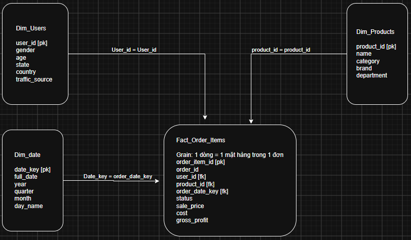
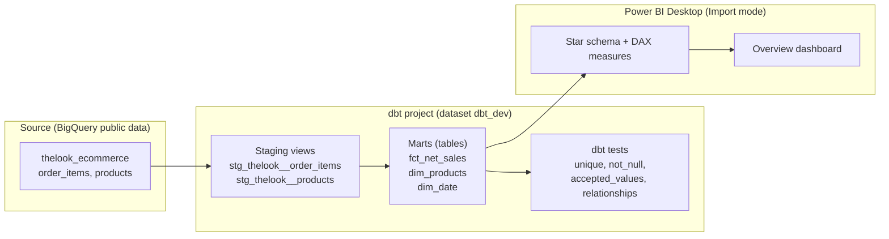
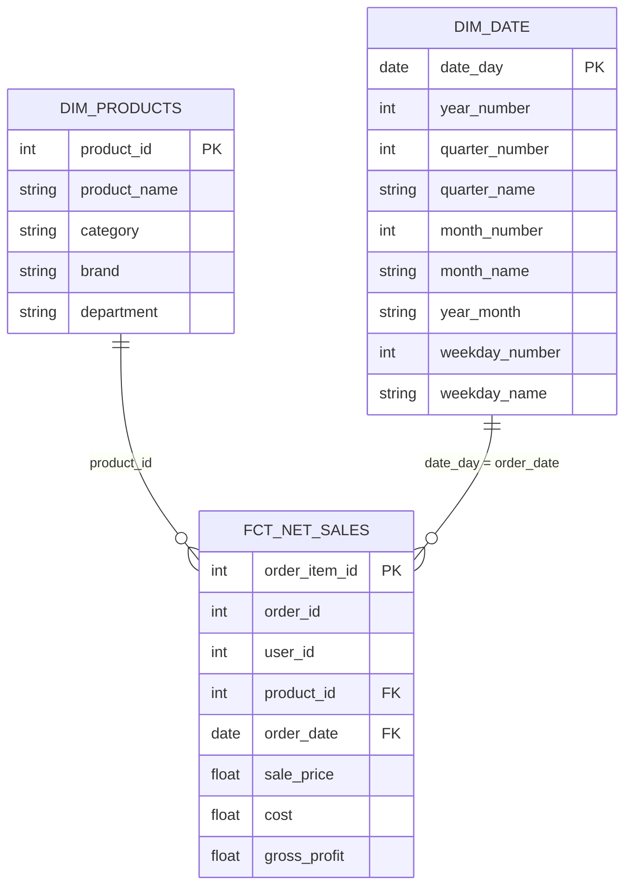
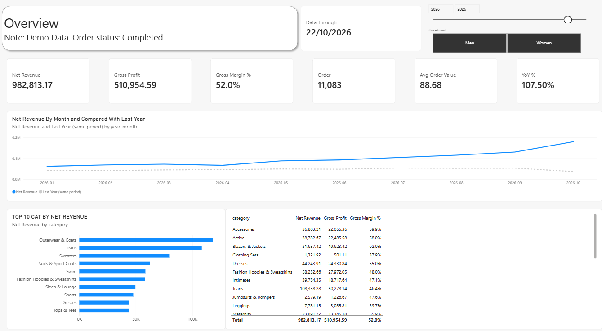
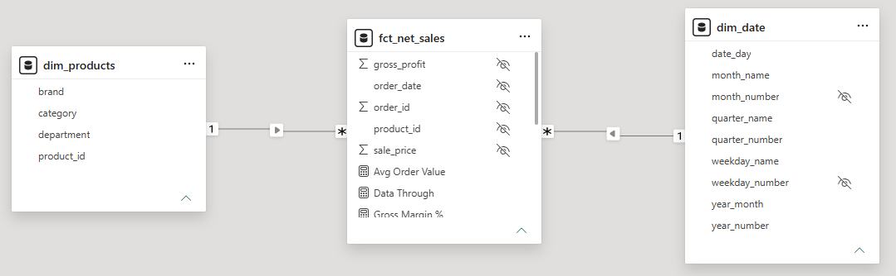
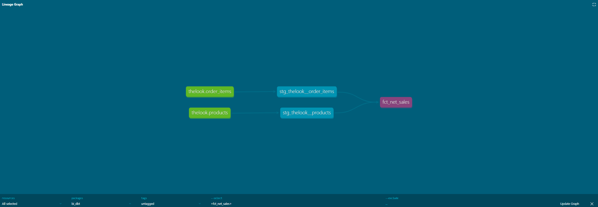

# data-pipeline-project

Dự án học BI + Data Engineering trên BigQuery. Repo gồm hai phần:

1. **Kho dữ liệu dạng star schema** dựng từ dataset công khai `thelook_ecommerce` (dataset `dwh`).
2. **Pipeline thời tiết** chạy bằng Python: gọi API, làm sạch, kiểm tra chất lượng, nạp lên BigQuery (dataset `raw`).

> Trạng thái: đang trong quá trình học (Tuần 5/8). Project 1 (net sales analytics) đã xong; Project 2 (dữ liệu thật) bắt đầu ở Tuần 6.

## Mục tiêu

- Xây pipeline dữ liệu **chạy lại nhiều lần vẫn cho cùng kết quả** (idempotent), có kiểm tra dữ liệu trước khi nạp và có log để truy vết khi lỗi.
- Giữ chi phí gần bằng 0: mọi query đều có giới hạn bytes tính tiền (`maximum_bytes_billed`).
- Không đưa dữ liệu hay bí mật (khóa API) lên repo công khai.

## Luồng dữ liệu của pipeline thời tiết


Nếu bước kiểm tra phát hiện lỗi, pipeline **dừng** và không nạp gì lên BigQuery.

## Sơ đồ bảng

### `raw.weather_daily`

Mỗi dòng là **một thành phố trong một ngày** (3 thành phố × 7 ngày dự báo = 21 dòng).

| Cột | Kiểu | Ý nghĩa |
|---|---|---|
| `time` | DATE | Ngày dự báo |
| `temperature_2m_max` | FLOAT | Nhiệt độ cao nhất trong ngày (°C) |
| `temperature_2m_min` | FLOAT | Nhiệt độ thấp nhất trong ngày (°C) |
| `precipitation_sum` | FLOAT | Tổng lượng mưa trong ngày (mm) |
| `city` | STRING | Tên thành phố |
| `ingested_at` | TIMESTAMP | Thời điểm lấy dữ liệu từ API (UTC) |

Bảng được nạp bằng `WRITE_TRUNCATE` (xóa cũ, ghi mới), nên chạy lại bao nhiêu lần cũng ra đúng 21 dòng, không bị trùng.

### Star schema (`dwh`)



Script tạo dataset: `SQL/Day 2/4_create_dataset_dwh.sql`.

## Cách chạy pipeline thời tiết

**Chuẩn bị**

- Môi trường Python có `requests`, `pandas`, `pyarrow`, `google-cloud-bigquery`.
- Một project Google Cloud và đã đăng nhập: `gcloud auth application-default login`.
- Sửa `PROJECT` ở đầu file `weather_pipeline.py` thành project của bạn, và tạo trước dataset `raw` (location `US`).
- API Open-Meteo không cần khóa.

**Chạy**

```
python "Python/Day 5/weather_pipeline.py"
```

Kết quả: log hiện trên màn hình và được ghi nối thêm vào `logs/weather_pipeline.log`. Pipeline trả mã thoát `0` khi thành công, `1` khi thất bại.

## Cấu trúc thư mục

```
Doc/                      Sơ đồ star schema
SQL/Day 2/                SQL tạo dataset dwh
Python/Day 3/             Gọi API, xử lý lỗi, retry, ghi JSON/CSV/Parquet
Python/Day 4/             Query có giới hạn bytes, nạp DataFrame lên BigQuery, đọc khóa từ .env
Python/Day 5/             weather_pipeline.py (pipeline hoàn chỉnh) và notebook thử nghiệm
.env.example              Mẫu biến môi trường (không chứa khóa thật)
CONTEXT.md, Notes.md      Ghi chú học tập
```

## Lưu ý an toàn

- Khóa API để trong `.env` (đã bị `.gitignore` chặn); chỉ `.env.example` được commit. Pipeline thời tiết hiện không cần khóa, nhưng `.env.example` cho thấy cách làm khi API cần khóa.
- Thư mục `data/` và `logs/` không được commit.
- Mọi query dùng `maximum_bytes_billed` làm cầu chì chi phí.

### Architecture



### Data model



## Project 1: Net sales analytics on thelook_ecommerce

An end-to-end BI project: BigQuery public data, dbt models with tests,
and a Power BI dashboard. Built to learn the toolchain; the data is simulated.

### What it answers
1. Revenue and gross profit this year vs the same period last year
2. Revenue by month
3. Which product categories sell the most, and at what margin


### Data model
Star schema. One row of `fct_net_sales` = one order item with status `Complete`.
- `fct_net_sales` (fact): order_item_id, order_id, product_id, order_date, sale_price, gross_profit
- `dim_products`: product_id, product_name, category, brand, department
- `dim_date`: one row per day, 2019-01-01 to 2027-12-31
Relationships are one-to-many, single direction, dimension to fact.

### Key numbers (snapshot, year 2026 data through 2026-10-22)
Net revenue 982,813.17 | Gross profit 510,954.59 | Margin 52.0% | Orders 11,083 | AOV 88.68
Each dashboard card was checked against an independent SQL query on the same snapshot.

### Data quality
dbt tests: unique and not_null on keys, accepted_values on department,
relationships from the fact to both dimensions. 14 tests pass.
Tests check structure, not values against the source, so source drift is not caught by them.

### Design decisions
- Revenue counts only `Complete` orders (rule lives in the mart, not in staging)
- Ratios are sum / sum (DIVIDE of two totals), never an average of ratios
- Power BI uses Import mode and only the columns it needs (.pbix 3.5 MB to 1.5 MB)
- Same-period comparison cuts last year at the last data date

### Cost controls
`maximum_bytes_billed` on every query (Python and dbt), dry run before running,
no `SELECT *`, Import mode so dashboard clicks do not query BigQuery.

### Limitations
- Source data is simulated and the public tables change over time
  (the count of Complete items moved between 45,282 and 45,529 across my snapshots)
- The latest order date can be later than today, which confirms the data is synthetic
- The .pbix file is not in the repo; screenshots are in Doc/
- Orders are assumed to belong to one department (verified for 2026 only)
- Refresh cost of Power BI not measured

### How to run
1. conda activate bi, gcloud auth application-default login
2. cd bi_dbt, then dbt run and dbt test
3. Open the dashboard in Power BI Desktop and Refresh

### Screenshots


